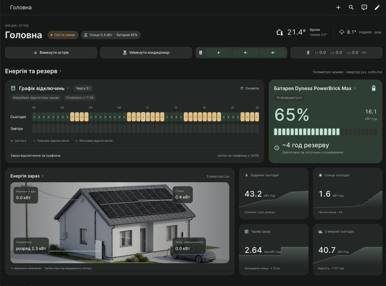

# Мій дім — тема Home Assistant

Темна тема в зелено-графітових тонах: м'які картки з радіусом 22 px, акцент `#b7e6ce`, попередження `#e9bf80`, шрифт Inter.
Змінює вигляд усього Home Assistant: бічну панель, верхню смугу, картки, діалоги, перемикачі, поля, Mushroom і Bubble Card.



Тема — частина дашборду «Головна v2». Самі картки з цього знімка лежать в окремому репозиторії
[ha-holovna-cards](https://github.com/haievyio/ha-holovna-cards). Тема працює і без них.

## Встановлення через HACS

1. HACS → ⋮ (угорі праворуч) → **Користувацькі репозиторії**.
2. Репозиторій: `https://github.com/haievyio/ha-moi-dim-theme`, тип: **Тема** (Theme) → **Додати**.
3. Знайдіть «Мій дім» у HACS → **Завантажити**.
4. Переконайтеся, що в `configuration.yaml` підключено теми:

   ```yaml
   frontend:
     themes: !include_dir_merge_named themes
   ```

5. Перезапустіть Home Assistant (або **Інструменти розробника → Дії → `frontend.reload_themes`**).
6. Профіль (ваше ім'я внизу бічної панелі) → **Тема** → «Мій дім».

## Вручну

Скопіюйте [`themes/moi-dim.yaml`](themes/moi-dim.yaml) у `/config/themes/` і виконайте кроки 4–6.

## Що варто знати

- Лише темний варіант, навмисно. Режим «Світла / Темна» у профілі на тему не впливає.
- Шрифт Inter: якщо його немає в системі, береться системний (San Francisco, Segoe UI, Roboto).
- Щоб тема діяла для всіх на всіх пристроях, увімкніть її за замовчуванням дією `frontend.set_theme` з `name: Мій дім`.

## Ліцензія

MIT
